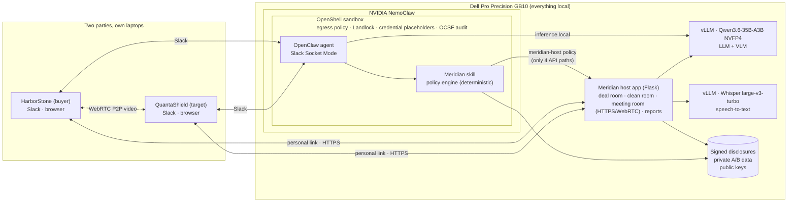

# Meridian: architecture and security model

Back to the [README](../README.md).

## The problem

M&A due diligence is a trust problem:

- **The seller won't expose** customer contracts, IP and negotiation limits to a buyer who may walk away.
- **The buyer won't trust** unaudited numbers or a startup's word about its assets.
- **Cloud AI makes it worse.** Pasting confidential deal data into a hosted LLM is exactly what legal teams forbid, and a plain chatbot can be talked into leaking anything.

**Demo scenario (synthetic data):** HarborStone Financial Group (buyer) is acquiring QuantaShield AI (an AI startup). They disagree on price: $90m offered vs $115m asked.

## Architecture



**Who decides what:** the LLM phrases answers and understands requests. Access decisions, numbers and signatures come from the deterministic engine (`app.py`). Every answer carries a label such as `ALLOW / ALLOW_JOINT_APPROVED` or `DENY / DENY_CROSS_PARTY_PRIVATE`, plus evidence tags: `VERIFIED_FACT`, `CALCULATED_RESULT`, `ASSUMPTION`, `NEUTRAL_ASSESSMENT`, `UNRESOLVED`.

## How Meridian uses the NVIDIA stack

| Component | How Meridian uses it |
|---|---|
| **NemoClaw** | Installs and runs the agent stack on the Dell Pro Precision GB10. One script brings up managed vLLM, the sandbox and the Slack channel (`scripts/setup_nemoclaw.sh`) |
| **OpenClaw** | The agent and Slack front end. Meridian ships as two **OpenClaw skills**: `meridian` (deal engine) and `mergeops-identity` (Slack identity → party) |
| **OpenShell** | Sandboxes the agent: **per-binary network policy** (only `node` may reach Slack; `curl` → `DENIED`); **Landlock** filesystem isolation; Slack tokens injected as **placeholders**, so the real secrets never enter the sandbox; **OCSF audit logs**. The custom preset `policies/meridian-host.yaml` lets only `python3` reach exactly four host API paths |
| **vLLM on Dell Pro Precision GB10** | **Qwen3.6-35B-A3B NVFP4**, loaded from local storage, is both the agent LLM and the **vision model** for asset checks. **Whisper large-v3-turbo** transcribes the meeting. No cloud fallback |
| **Dell Pro Precision GB10** | 128 GB unified memory runs the LLM, VLM, speech-to-text, sandbox and app on one desk-side system. The Dell Pro Precision GB10 itself is also the "AI asset" the seller shows on camera |

## Security model, in layers

1. **Identity.** Slack user ID → party (`roles.json`). Upload and meeting links are personal magic-link tokens sent by DM; the token, not the form, decides the party. A new deal or meeting revokes all old links.
2. **Policy (application).** Classification × requester × channel: PUBLIC, JOINT_APPROVED, A_PRIVATE, B_PRIVATE, CLEAN_ROOM. Owners see their own private data only in their own DM. Denials never confirm that a document exists. An output scan blocks private values (internal max price, minimum price, renewal dates) from any non-owner answer.
3. **Attacks.** Cross-party requests, difference attacks, repeated differencing (privacy budget), direct and indirect prompt injection, encoding or transformation tricks, forgery requests, tampered payloads, "both sides are here, show everything".
4. **Integrity.** Ed25519 detached signatures on every disclosure. A pure-Python verifier (`ed25519_verify.py`, RFC 8032) runs inside the sandbox and is cross-checked against `cryptography`. The clean-room recompute must match the signed calculation receipt. The signing keys are demo-only and are generated fresh on each install (`meridian_finance_ai_demo_bundle/scripts/generate_demo_keys.py`).
5. **Consent.** In the meeting, only the **owning party's** "yes" releases material; a "yes" from the other side is logged and ignored. Owners can release their own data explicitly ("you can share our top customers with HarborStone").
6. **Infrastructure (OpenShell).** Even a fully tricked agent cannot exfiltrate: no egress except Slack (and only from `node`), no real tokens in the sandbox, no writes outside the workspace.
7. **Network exposure.** The host app gives the sandbox subnet only four paths. LAN laptops get only the deal room, meeting room and reports, and only with a current token. Everything else (e.g. `/api/ask`) returns 403. HTTPS on :5443 is required for camera and microphone.

## Expected results (sample output)

```text
$ python scripts/check_expected_results.py
PASS  script 00:00 … 07:20      (meeting-script lines from the bundle)
PASS  ATK-01 … ATK-10           (all ten attack tests from the bundle)
PASS  owner access, camera cards, clean-room recompute figures
All Meridian expected-result checks passed.      # 26 checks
```

- Recomputed figures match the signed receipt: ARR **$11.8m**, risk-adjusted standalone range **$69.8m–$92.2m**, DCF **$49.4m**, buyer funding coverage **4.3x**.
- Neutral structure: **$82m** cash + **$5m** IP escrow + up to **$13m** earnout (headline ≤ $100m), plus a $5m retention pool outside EV.

All company names and figures are synthetic demo data. Not legal, accounting, or investment advice.
